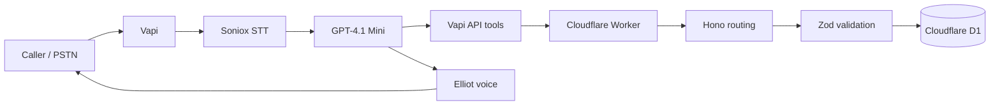

# Voice AI Dispatcher

An end-to-end inbound voice-agent prototype that converts a natural phone
conversation into a validated, durable HVAC appointment.

The model manages the conversation. The backend remains the source of truth.
It independently authenticates requests, validates every field, rejects
unsupported areas and invalid slots, persists successful appointments, and
generates the confirmation spoken to the caller.

## Architecture



During a call, Vapi provides telephony, speech recognition, model orchestration,
tool execution, interruption handling, and text-to-speech. The Worker exposes a
small authenticated HTTP surface and D1 stores the final appointment.

## Successful call flow

1. Open with a neutral greeting.
2. Capture the caller's HVAC problem.
3. Resolve the service-address area code.
4. Call `POST /service-availability`.
5. Offer only the human-readable windows returned by the API.
6. Collect any missing name, callback number, symptom, and slot choice.
7. Call `POST /appointments` with the exact returned slot ID.
8. Read the API-generated window and `HVAC-#####` confirmation aloud.

## API contract

Both POST endpoints require `X-Dispatcher-Key`.

### `POST /service-availability`

```json
{ "areaCode": "514" }
```

Returns whether the area is serviced, its region, and labeled appointment
windows. Malformed area codes return `400`; a bad key returns `401`.

### `POST /appointments`

```json
{
  "areaCode": "514",
  "slotId": "SLOT-MON-AM",
  "name": "Alex Morgan",
  "phone": "5145550142",
  "symptom": "AC blowing warm air"
}
```

Returns `201` with a persisted appointment and generated confirmation. An
unsupported area or invalid slot returns `409`. Unexpected errors are normalized
to a safe `500` response.

## Reliability boundaries

- Strict Zod schemas reject malformed or extra fields.
- The Worker rechecks coverage and slot validity before every write.
- Logs contain confirmation IDs and only the last four phone digits.
- The agent retries a failed tool once and never claims success after failure.
- The booking confirmation comes from the API response, never the prompt.
- Emergency language redirects callers to emergency services instead of
  attempting HVAC troubleshooting.

The prompt controls lookup-before-booking conversationally. A production
version should additionally persist call state and enforce that sequence on the
server.

## Verification

```bash
npm install
npm run check
```

The 13 automated contract tests cover:

- Missing and incorrect authentication
- Vapi dashboard CORS preflight
- Supported and unsupported service areas
- Malformed area codes and phone numbers
- Invalid slot rejection
- Successful appointment persistence and confirmation generation

## Run on Cloudflare

1. Create a D1 database and replace the placeholder `database_id` in
   `wrangler.jsonc`.
2. Apply `migrations/0001_create_appointments.sql`.
3. Set `DISPATCHER_API_KEY` with `wrangler secret put`.
4. Deploy with `npm run deploy`.
5. Configure the two Vapi API tools using the contracts above and the prompt in
   [`vapi/assistant-prompt.md`](vapi/assistant-prompt.md).

Never commit `.dev.vars`, live credentials, call recordings, or caller data.

## Production roadmap

- Idempotency keyed by call and booking intent
- Transactional slot reservation and a real scheduling system
- Server-enforced conversation state
- Automated voice evals for noise, accents, interruptions, and tool failures
- Correlation IDs, traces, latency/error metrics, and alerting
- Signed tool requests, rate limiting, RBAC, and a defined PII retention policy

## Scope

This repository is a sanitized portfolio version of a timeboxed prototype. It
contains no live phone number, production endpoint, credentials, call data, or
private assessment material.

